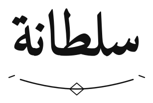
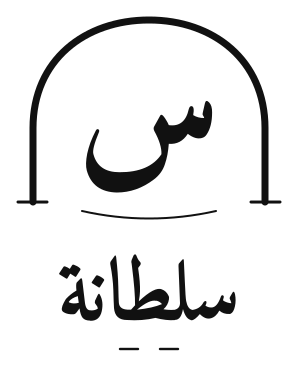
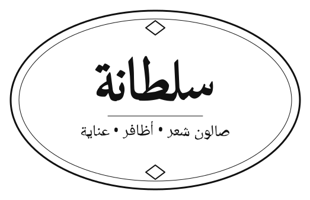

# سلطانة — مفاهيم الشعار | الجولة الأولى

> **الحالة:** مفاهيم استكشافية بالأبيض والأسود، وليست هوية نهائية معتمدة. الملفات SVG تتضمن مسارات Vector بعد تحويل الكتابة العربية إلى أشكال، ولا تتطلب تثبيت الخط لعرضها. لكن هذا لا يعني أن الحروف رُسمت يدوياً بالكامل: تعتمد هذه الجولة على خطوط عربية كأساس بصري، وسيكون تخصيص الحروف وفحص تفاصيلها خطوة لاحقة قبل الاعتماد.

## A — كلمة سلطانة (التوصية الأولية)

الفكرة: الاسم نفسه هو العلامة؛ معالجة كتابية عربية أولية مع خط سفلي هادئ. التوصية الأولية لأنها تبني التذكر على الاسم، وتبتعد عن رموز الصالونات النمطية.

## B — حرف س داخل قوس

الفكرة: مونوغرام لحرف «س» داخل قوس معماري مع الاسم أسفل العلامة. يُحتمل أن يكون الأنسب لصورة الحساب إذا أثبت الرمز تميّزه عند التصغير.

## C — ختم سلطانة

الفكرة: ختم بيضاوي رقيق يجمع الاسم ووصف الخدمات. يناسب بطاقات المواعيد أو التطبيقات المطبوعة، لكنه يحتاج اختباراً لتفادي الازدحام عند الحجم الصغير.

## ما تم اختباره
- ملفات SVG تفتح وتُصيّر محلياً عبر Inkscape.
- تحقّق بنيوي من صلاحية XML، وغياب عناصر النص الحية والصور المضمّنة والفلاتر والتدرجات في ملفات المفاهيم.
- لون واحد (أسود) لتقييم الفكرة قبل اعتماد الألوان.
- معاينة إجهاد بحد أقصى 64 و32 و16 بكسل؛ حجم 16 بكسل اختبار ضغط وليس وعداً بإمكانية قراءة الشعار الكتابي بهذا الحجم.
- هذه الفحوص لا تغني عن مراجعة بصرية بشرية أو بحث قانوني عن العلامات التجارية.

## التسليم النهائي
حزمة المفاهيم الكاملة ومعاينات PNG واختبار الأحجام متاحة أيضاً كمرفق في المحادثة. اختر A أو B أو C، أو اطلب مزج عناصر منها، قبل إعداد حزمة الهوية النهائية.
